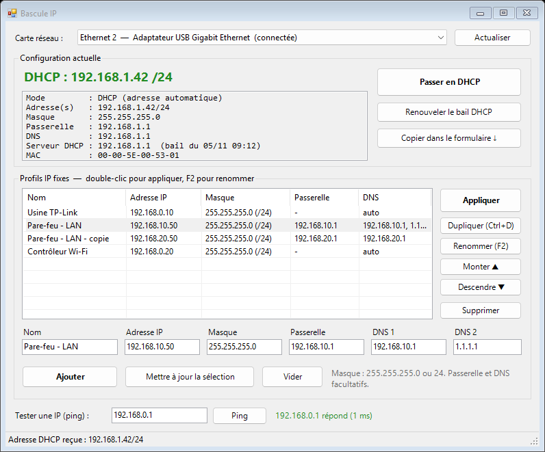

# Bascule IP

Petite interface graphique PowerShell pour **passer une carte réseau de DHCP à une IP fixe en un clic**, et inversement.
Pensée pour configurer du matériel neuf (switch, borne Wi-Fi, pare-feu…) : on enregistre une fois les adresses dont on a besoin, puis on bascule de réseau en réseau sans repasser par les paramètres de Windows.



## Fonctionnalités

- **DHCP** : passage en DHCP, puis affichage de l'adresse reçue, du serveur DHCP et du bail. L'attente se fait sans bloquer la fenêtre.
  - L'absence de serveur DHCP est signalée (adresse automatique 169.254.x.x, en orange).
  - Un conflit d'adresse est signalé en rouge.
- **Profils d'IP fixe** :
  - les créer (nom, IP, masque, passerelle et DNS facultatifs) ;
  - les appliquer par **double-clic**, Entrée ou le bouton « Appliquer » ;
  - les **dupliquer** (Ctrl+D) pour ne changer que le nom et un octet ;
  - les **renommer** (F2), les réordonner, les supprimer (avec confirmation).
- **Copie de la configuration actuelle** dans le formulaire, pour l'enregistrer comme profil.
- **Ping** intégré, pour vérifier qu'un équipement répond (son adresse par défaut, par exemple).
- **Contrôle des saisies** : masque non contigu, adresse de réseau ou de broadcast, passerelle hors du réseau sont refusés.
- **Mode simulation** `-WhatIf` : aucune modification de la carte, tout est journalisé.

## Prérequis

- Windows 10 / 11 avec **Windows PowerShell 5.1** (compatible PowerShell 7).
- **Droits d'administrateur local** : modifier l'adressage IP l'exige. Le lanceur demande l'élévation (UAC).

## Installation

1. Télécharger ou cloner le dépôt et garder les fichiers ensemble dans un même dossier (une clé USB convient).
2. Si les fichiers viennent d'Internet, les débloquer une fois, sinon la stratégie `RemoteSigned` les refuse :
   ```powershell
   Get-ChildItem -Path . | Unblock-File
   ```

## Utilisation

Double-cliquer sur **`Lancer-BasculeIP.cmd`**. Il demande l'élévation et masque la console.

En ligne de commande, depuis une console PowerShell lancée en administrateur :

```powershell
# Simulation : rien n'est modifié
.\Switch-IPProfile.ps1 -WhatIf

# Présélectionner une carte (adaptateur USB, par exemple) et afficher le détail du journal
.\Switch-IPProfile.ps1 -InterfaceAlias 'Ethernet 2' -Verbose
```

| Paramètre | Rôle | Valeur par défaut |
|---|---|---|
| `-InterfaceAlias` | Carte présélectionnée | première carte physique connectée |
| `-ProfilePath` | Fichier des profils | `Profils-IP.json` à côté du script |
| `-LogPath` | Dossier du journal | `%ProgramData%\Scripts\Logs` |
| `-DhcpTimeout` | Attente maximale d'une adresse DHCP (5 à 120 s) | 30 |

## Profils et journal

- Les profils sont enregistrés dans **`Profils-IP.json`**, créé au premier enregistrement. Ce fichier est propre à chaque utilisateur : il est exclu du dépôt (`.gitignore`).
- À chaque modification, la version précédente est gardée en `Profils-IP.json.bak`.
- Le journal `Switch-IPProfile_<date>.log` trace qui a lancé l'outil, sur quel poste, et la **configuration de la carte avant chaque changement**. C'est elle qui sert au retour arrière.

## Points de vigilance

- Changer l'adressage **coupe les connexions** qui passent par la carte (prise en main à distance, RDP, partages). Il vaut mieux utiliser un adaptateur USB dédié à la configuration du matériel.
- Le passage en DHCP retire les IP fixes, la passerelle et les DNS fixes de la carte.
- Seul l'IPv4 est géré.

## Licence

Distribué sous licence [MIT](LICENSE) : réutilisation, modification et redistribution libres, à condition de conserver la mention de copyright. Fourni « en l'état », sans garantie.
